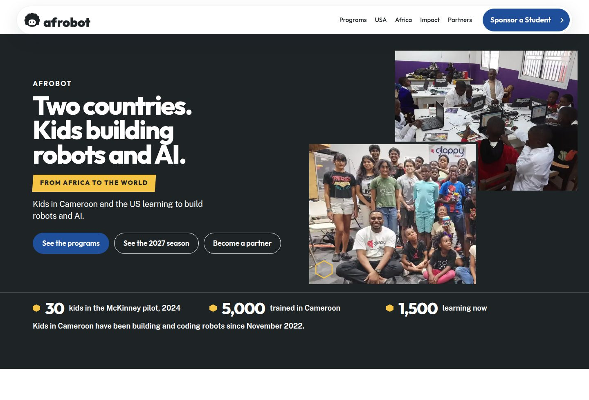
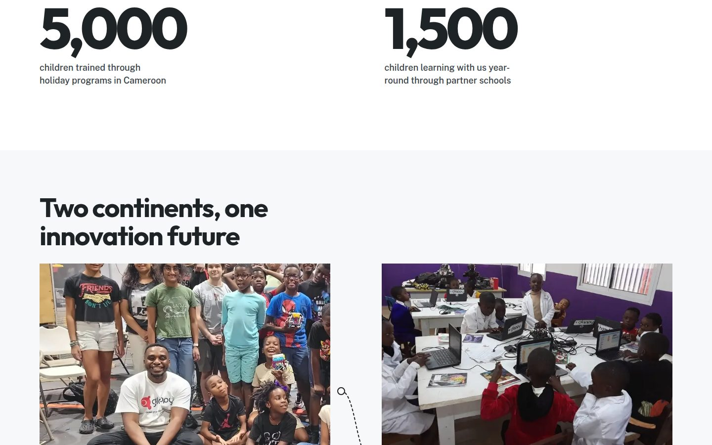
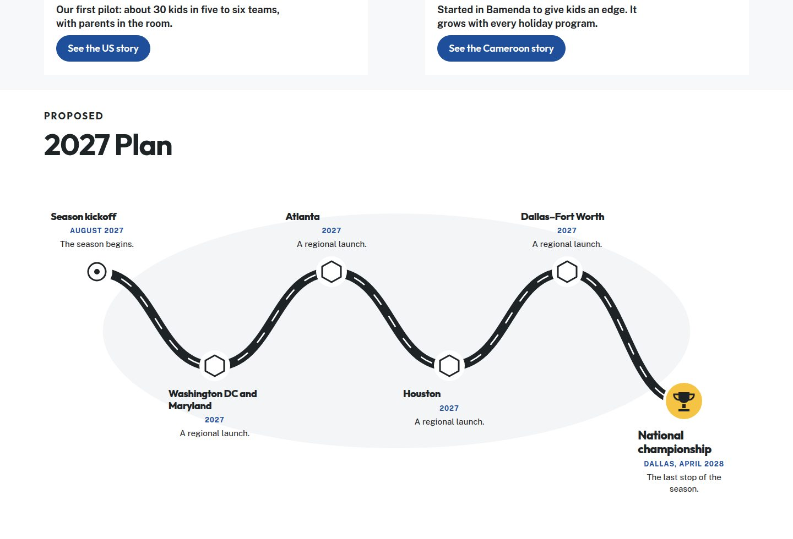
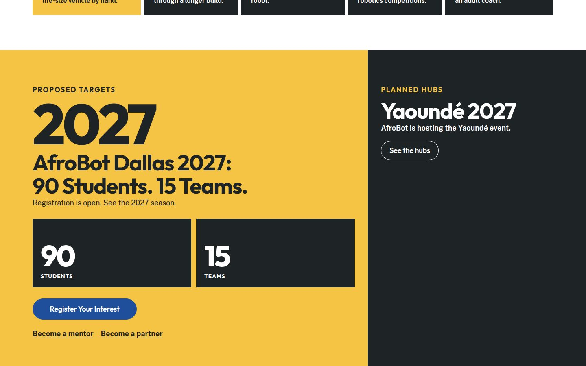
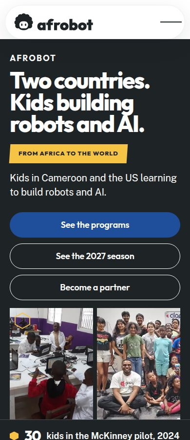
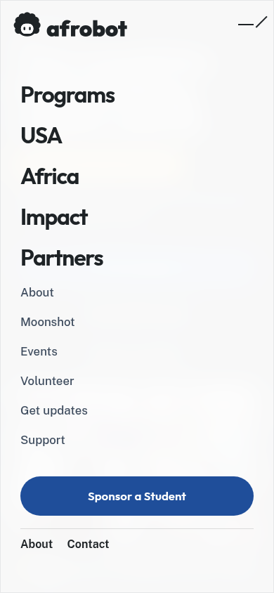
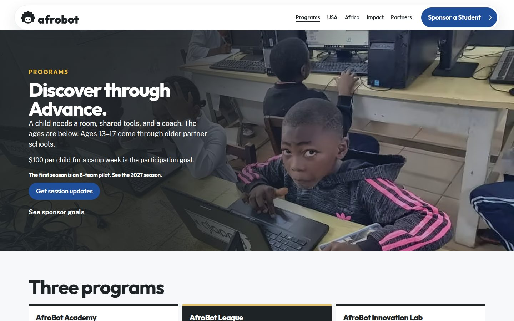
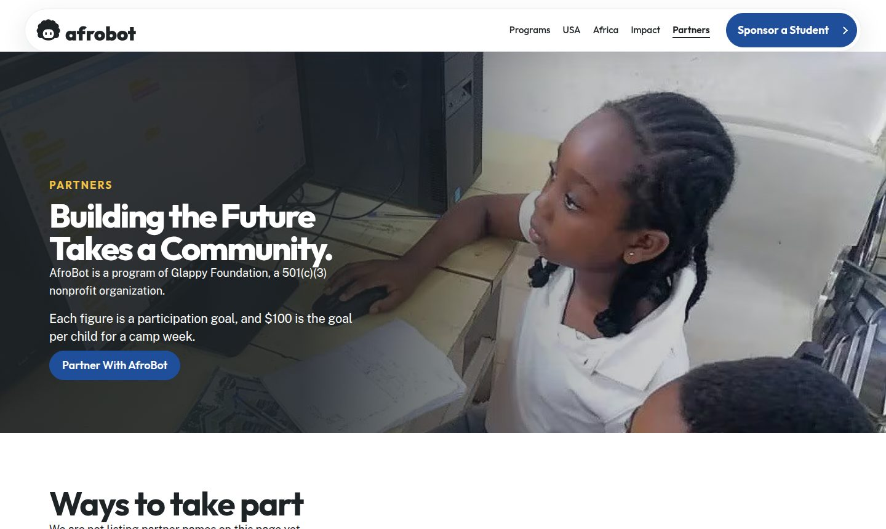

# AfroBot public-site audit

17 November 2026. Reviewed the site as a program officer would, on a 1440px desktop and a 390px phone, against the repository at `2f1f8bf` (the commit then on `main`). That build is what [afrobot.org](https://afrobot.org) and the Vercel project `afrobot-ruddy` serve. Reference points for tone were the Gates Foundation, Code.org, FIRST, Africa Code Week, Teach For All, and Ashesi. Nothing below copies their layout.

The photographs of children at work are a real strength. The problem is that the words around them do not yet tell one fundable story.

## What the first screen should answer

| Question a funder asks | What the site does today |
| --- | --- |
| Who is this for, and where? | The hero says “two countries” and then repeats the same idea. Dallas–Fort Worth and Cameroon are real, but they arrive after the slogan. |
| What problem are you working on? | The home page never states one. The Bamenda school-week fact lives only on the Africa page. |
| What do you actually do? | Three different answers: life-size vehicles, humanoid robots, and an 8-team pilot. |
| What have you already done? | About 30 children in McKinney in 2024, and the Cameroon counts. Then the same counts are shown again. |
| What is the next use of money? | A five-city road to a 2028 trophy, a yellow block that says registration is open for 90 students, and a page that calls 2027 an 8-team pilot. |
| How do I start a conversation? | The header button is “Sponsor a Student,” a $100 camp-week goal. |
| Can I trust the legal and evidence claims? | The site says Glappy Foundation is a 501(c)(3). The foundation’s own page does not, and an internal risk note says the determination is unconfirmed. |

## Priority findings

### P0 — fix before this URL is sent to a funder

1. **The 2027 plan contradicts itself.** The home page says “AfroBot Dallas 2027: 90 Students. 15 Teams.” and “Registration is open.” Programs, Competitions, USA, and Contact say “The first season is an 8-team pilot. Teams are about 8 students plus coaches.” Terms and About say sessions are not open. A reader cannot tell whether they are being asked to fund a pilot, a 15-team season, or an enrollment that is already open.

2. **The roadmap overclaims the geography.** The home page draws Washington DC and Maryland, Atlanta, Houston, Dallas–Fort Worth, and an April 2028 national championship as one road, under a single “Proposed” label. The current plan to discuss with partners is a Dallas–Fort Worth scale-up of the 2024 pilot (about 15 teams, about 90 children), with the Cameroon program continuing. The other cities are a later hope. Giving them the same visual weight as the work already done makes the organization look unfocused.

3. **There is no funder narrative on the home page.** A credible development site moves from problem, to approach, to proof, to the scale-up, to a specific ask. This home page moves from slogan, to the same slogan, to a poster of age bands, to a second slogan (“Two Continents. One Innovation Future.”), to a sponsorship button. The 2024 pilot and the Cameroon classrooms are present, then buried.

4. **The institutional ask is a $100 button.** “Sponsor a Student” is a real, useful gift. It is the wrong first action for a foundation or a university. Partnerships has a form and `partnerships@afrobot.org`, but the header, the hero, and the footer all point at the small-gift frame. The partners page opens with “Building the Future Takes a Community” and the camp-week price.

5. **Tax status is stated more strongly than the public record supports.** About, Partners, and Partnership say “AfroBot is a program of Glappy Foundation, a 501(c)(3) nonprofit organization.” [glappy.com/foundation](https://www.glappy.com/foundation) describes Glappy Foundation (Glappy Foundation Inc.) as a Texas nonprofit corporation, separate and distinct from Glappy Inc., and does not say 501(c)(3). `docs/transformation/risks.md` says that standing was unconfirmed and that the site must not claim deductibility. Sending the current sentence to a foundation is a fact-check risk. The site also never explains the Glappy Inc relationship, which is the question a partner will ask.

### P1 — needed for a coherent, trustworthy visit

6. **The same facts are repeated instead of explained.** Home shows 30 / 5,000 / 1,500 in the hero, then 5,000 and 1,500 again, then 30 and 5,000 again in the place cards. Nothing says these are founder-reported (November 2026), or how the holiday total differs from “learning now.” The foundation page publishes 1,500 children in the program and four-plus years. It does not publish 5,000. Both numbers can be true, and a funder will compare the two sites.

7. **The program model changes by section.** Discover and Build are life-size vehicles. Innovate and Compete are humanoid robots and “recognized” competitions, with no competition named. The 2027 build a partner is actually being asked to support — small humanoid robots from open-source schematics and 3D-printed parts, plus training, safety, and a showcase — is not on the site.

8. **Unnamed schools were correctly omitted.** The partners page does not list partner names until a partnership is confirmed. That is safer than a logo for a conversation that is not an agreement.

9. **Trust sections a funder expects are missing, and the site does not say so.** No theory of change, no outcomes beyond headcount, no budget or use of funds, no founder biographies (the About portraits are captioned “Founder” and “Founder. WAAW Foundation.”), no consented reflections, no partner list. The USA page’s lesson from the pilot is “a very exciting, magical, beautiful experience.” That is not a finding.

10. **Navigation and the phone layout are one step short of the photography.** Primary nav is Programs, USA, Africa, Impact, Partners, which is a sound set. About is missing from it and then appears twice in the phone menu. The text links collapse into a hamburger at 1080px, so a small laptop loses them. The phone hero stacks three full-width buttons under a headline that repeats the subhead. The footer is solid: email, policies, child safety, and a copyright.

11. **Metadata is technically present and editorially thin.** Favicon, canonical URL, sitemap, `robots.txt`, and an Open Graph image all exist. The share image is a logo plus a classroom crop and the tagline, which is acceptable, and it does not say who the program is for or where it works. The home title restates the hero slogan. Lighthouse does not catch that.

### P2 — polish after the story is stable

12. **The visual system has a name for colors it no longer uses.** Graphite `#1E2326`, yellow `#F6C445`, blue `#1F4E9A`, Outfit, and Public Sans are consistent and the contrast pairs the lint checks do pass (yellow on graphite is about 9.7:1). `tokens.css` still calls the blue “clay” and comments that buttons are orange. Styles are split across `styles.css`, `components.css`, and `visual.css` (about 4,000 lines), with unused rules. Lighthouse on the local server: desktop 100/100/100/100, mobile performance 91 (LCP 3.2s, render-blocking CSS, unused CSS, heavy images). Production Vercel compresses text; the local server does not, so the compression finding is partly the test setup. Scroll-reveal sets later sections to `opacity: 0` until they enter the viewport.

13. **A few tools and pages feel unfinished.** The programs “Which stage fits?” tool only offers ages 6–12 and always answers Discover or Build. The Social page is an email pointer. The README still says there is no build step and that the body font is Inter. YouTube posters load from `i.ytimg.com`. None of this blocks a partner email. It does not help.

14. **Forms work.** `POST https://afrobot.org/api/interest` with an empty body returns 422 and field errors, and does not create a record. The same form is on Community, Mentorship, Partnership, and Volunteer (`/api/volunteer`). Child safety covers screening, supervision, the two-adult rule, photo consent, reporting, and event safety, and it points at `info@afrobot.org`.

## Page notes

- **Home.** Strongest photographs on the site, in the hero. The McKinney group and the Bamenda classroom are children at work, which is the right frame. The page then spends its length on slogans, a five-stop road, and a second copy of the impact numbers.
- **Programs.** Clear age path and an honest $100 goal, including the $10 workshop line that says it is not today’s price. The 8-team sentence at the top undoes the home page.
- **USA.** The pilot story and the film are credible. “What we learned” is not. The page then repeats the 8-team line.
- **Africa.** The Bamenda school-week account matches the foundation site and is specific. The galleries are children building, not distress. The ask at the bottom is “host a session,” not a partnership.
- **Impact.** Honest that a later count may move the numbers. Too short to be the page a grants reader was sent to find.
- **Partners.** Correctly refuses to list names. The money bands ($100 to $25,000, each a goal) have no sentence on what a larger gift pays for.
- **About.** Legal home, founders, values, and the access principle are the right ingredients. The biographies are one line. “Sessions aren’t open yet” is the line the rest of the site should agree with.
- **Contact.** `info@afrobot.org` only. No street address, which is appropriate. The yellow band repeats the 8-team claim.
- **Footer and policies.** Privacy, terms, child safety, and accessibility are linked. Copyright is “© 2026 AfroBot.” Glappy Foundation is correctly kept off the footer legal row and stated on About.

## Lighthouse

Local static server, 17 November 2026, Chrome, homepage.

| | Performance | Accessibility | Best practices | SEO |
| --- | --- | --- | --- | --- |
| Desktop | 100 | 100 | 100 | 100 |
| Mobile | 91 | 100 | 100 | 100 |

Mobile LCP was 3.2s. Accessibility at 100 does not mean the narrative, the duplicate menu item, or the contradictory facts are fine. Those are outside what Lighthouse scores.

## Before screenshots

Hero, desktop. The photograph is the credible part. The headline, the yellow tag, and the sentence under it say the same thing, and the first action is a program list.

Place cards, then the start of a “2027 Plan” that is about to list five US stops.

The roadmap. Dallas–Fort Worth is one stop among five, and a trophy marks an April 2028 championship.

The same page, lower down, says registration is open for 90 students and 15 teams.

Phone hero. Three stacked buttons, and the proof line repeats the headline.

Phone menu. About is listed twice. The action is still “Sponsor a Student.”

Programs tells a funder the first season is an 8-team pilot.

Partners leads with a slogan and the camp-week goal.

## What this audit did not do

No partner, funder, quote, logo, or headcount was added in order to make the screenshots look more complete. Gates Foundation is a reference for tone only. It is not a funder or a partner of AfroBot.
