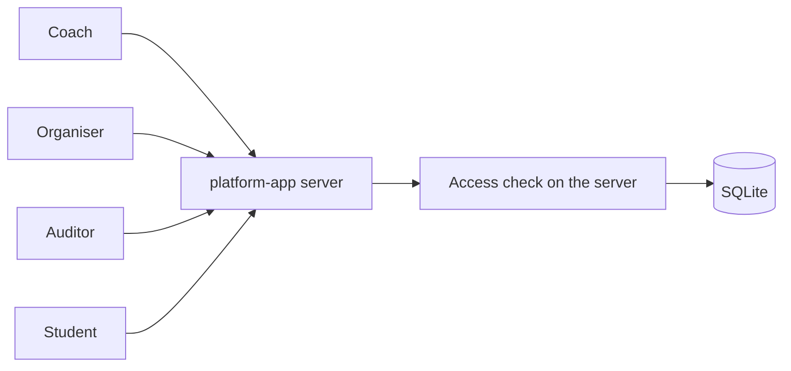
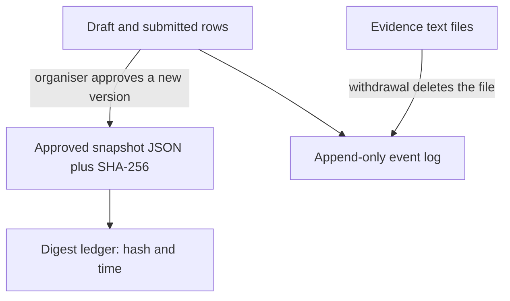

# AfroBot evidence platform (local demo)

Private pilot for reviewing a claim without exposing a learner. It is a separate app from the public AfroBot site. The public pages, navigation, Impact page, and Vercel project settings are unchanged. This folder is listed in `.vercelignore`, so a deploy of the static site does not publish it.

Every school, count, and login in here is fictional. Sign-in is mocked. There is no external account service and no AI recommendation.

The workspace uses the live afrobot.org look: Public Sans, navy `#0E2747`, terracotta `#C4461A`, a white header, and the same robot wordmark. The left nav, records grid, provenance, integrity check, legal hold, and access review stay in place. Those controls follow the ideas in ISO 15489, ISO 16175, NIST SP 800-53 AU, W3C PROV, and a SOC 2 control mindset. This demo is not certified, and it is not affiliated with any records body or prize.

## Run

Requires Node.js 22.13 or newer (this demo uses the built-in `node:sqlite` module).

```bash
cd platform-app
npm install
npm run demo
```

Open http://127.0.0.1:8787

The first start creates `platform-app/data/demo.sqlite` and seeds the story below. Delete that folder to start over. `npm test` runs the unit tests and the access tests.

There is no private staging URL. The public site is a static Vercel project and cannot host this server without a new service. Nothing here was deployed.

## Demo logins

Passwords are fictional and exist only for this demo. Do not reuse them.

| Who | Username | Password | What they can open |
| --- | --- | --- | --- |
| Coach A, Cameroon | `coach-a` | `demo-coach-a` | North Ridge Learning Circle (fictional) |
| Coach B, Tanzania | `coach-b` | `demo-coach-b` | Lakeside Makers Circle (fictional) |
| Organiser | `organiser` | `demo-organiser` | Both fictional schools. Approves. Does not submit. |
| Auditor | `auditor` | `demo-auditor` | Cameroon school only, read-only, until 1 June 2027 |
| Learner CM-1 | `student-a` | `demo-student-a` | Their own draft |
| Learner CM-2 | `student-b` | `demo-student-b` | Their own draft, used to prove the other learner cannot open it |

The login page repeats this table. A banner on every page says the sign-in is mocked.

## What the seeded story shows

Coach A submitted 8 starters and 6 rubric finishers on 24 April 2026. The organiser, a different account, approved that version. Coach A then filed a correction dated 2 May 2026: the numerator changes from 6 to 5 because one finisher had only done the paper/plastic sorter practice lesson. The organiser approved the correction on 3 May 2026.

Both approved versions remain. Each has its own SHA-256 digest.

- Version 1, superseded: 6/8 = 75%, digest `7906c75cf9645c2e5e23a01335814e43477ab4002cce0f8e0d8e2a6f7903e45f`
- Version 2, current: 5/8 = 62.5%, digest `5c9ab2b47e96bef4b9f69c20fa432dbf5ccb9db4729da89067bb4758b51596e1`

The auditor opens the current figure, the superseded snapshot, and the redacted test log, then exports a pack. Coach B's claim (2/4, still waiting) is a different school and is not in that pack.

The season project is separate from the practice lesson. The fictional Cameroon project is an SDG 12 station checklist: baseline 40 mis-sorts per 100 items, later count 25 per 100, same item mix. It shows as output and confirmed use. It is not a verified outcome until the organiser approves it. The Tanzania project is an SDG 6 paper map and does not prove water access or safety. Each project is counted once under its primary goal.

The sorter lesson has a button that tries to mark the season project complete. The server refuses.

A removable synthetic note is already withdrawn. The file is gone. The event keeps the evidence id and none of the text.

Peer review from a fictional Tanzania team asked for a second-day recount. The reply records that one change. The showcase fallback is a remote call. Travel is not required.

The U.S. season is an unpublished draft. It holds a copy of the approved rubric, the practice lesson, and the coach card. It has no projects, no learners, and no grants. The copied lesson still cannot complete a season project.

Follow-up rows for an independent rerun, STEM participation at 6 and 12 months, and a second joint project are blank. They are not stored as zero.

### Season comparison

These figures are fixtures, not the school claim above. Coach-hours include preparation, delivery, follow-up, and any central coaching time.

| Case | Baseline | Candidate | Result |
| --- | --- | --- | --- |
| Like for like | 24 completions / 24 coach-hours | 36 / 18 | 1 versus 2 per hour and 2× |
| Scope differs | same counts | different age or tier | multiplier suppressed |
| Rubric differs | same counts | different rubric version | multiplier suppressed |
| Baseline missing | same counts | baseline not measured | multiplier suppressed |
| Coverage missing | same counts | coverage empty | multiplier suppressed |
| Guardrail | same 1 versus 2 per hour and 2× | learning worsened | human decision: hold |

10× is named on the organiser page only as a stretch hypothesis for a bottleneck someone might pick later. It is not the result and not a goal. Nothing on the page recommends a next step. A person records the hold.

## Role matrix

A denied record returns HTTP 404 and the body `{"error":"Not found"}`. The HTML page says the record is not available and does not repeat the id, the school, or the count. An auditor who can already read a Cameroon record and tries to edit it gets HTTP 403 `{"error":"Not available"}`.

| Action | Coach | Organiser | Auditor | Student |
| --- | --- | --- | --- | --- |
| Read a claim or school project | Own school | Schools assigned to them | Active grant only | No |
| Read another school's record | No | No | No | No |
| Read a learner draft | No | No | No | Own draft only |
| List | Own school, no drafts | Assigned schools, no drafts | Grant scope only | Own drafts only |
| Edit or submit a claim | Own school | No | No | Own draft text only |
| Approve | No | Yes, and not their own submission | No | No |
| Download an evidence file | Own school, active file | Assigned school, active file | Redacted active file inside the grant | No |
| Download a withdrawn file | No | No | No | No |
| Export a claim pack | Own school | Assigned school | Grant only | No |

The checks run on the server for every read, edit, list, download, and export. Filtering a list is done in the query path before the response is built. A coach cannot post another school's id and have the row saved there.

## Data flow





An approved claim row cannot be updated. A correction is a new row that points at the previous one. The snapshot and the digest ledger are insert-only. The event log is insert-only. SQLite triggers reject `UPDATE` and `DELETE` on those three tables. The digest ledger is the copy that routine editing is not supposed to touch. In this demo it still sits in the same database file. A later deployment should copy it, with the timestamp, to storage the day-to-day editor does not use.

The hash detects a difference after the snapshot was written. It does not detect a false count that was typed in and then approved. There is no blockchain and no public trust mark.

Check a pack with:

```bash
node scripts/validate-snapshot.mjs ../docs/platform/export-pack/snapshots.json
```

## Example export

`docs/platform/export-pack/` is the auditor pack for the current Cameroon claim. It contains `manifest.json`, `claim.csv`, `claim.json`, `evidence.csv`, `evidence.json`, `snapshots.json`, and `events.json`. The manifest lists a SHA-256 for each file. Regenerate it with `npm run write-example-pack`.

The pack includes the 6/8 snapshot and the 5/8 snapshot. It does not include the Tanzania claim, a roster, a password, or the withdrawn note.

## Tests

`npm test` covers:

- the 24/24 versus 36/18 comparison, the four suppressions, and the guardrail hold
- blank rates when a denominator is missing
- stable SHA-256 canonical JSON
- the coach → organiser → correction → auditor export path, including that the first digest is unchanged
- the sorter refusal, one project per goal, a result correction, and withdrawal of a private file
- the U.S. material copy with zero projects and zero learner rows copied
- triggers that block edits to approved claims, snapshots, the ledger, and events
- API denials for the other coach, the auditor editing or opening unassigned material, and a learner opening another learner's draft
- an expired grant and a revoked grant

Latest local run: see `docs/platform/TEST-RESULTS.md` after `npm test`.

## What is mocked

- Usernames, passwords, and the session cookie. The cookie is an httpOnly session id stored in SQLite. There is no password hash and no outside identity provider.
- Both schools, both cohorts, every count, the community verifier role, the peer note, and the U.S. season.
- Evidence files. The seed still uses short text notes. A coach can also attach a private photo. The bytes stay in the database and are served only through a signed-in route. There is no public photo URL, no video, and location data is removed before storage.
- The "independent verifier" is a role label, not a person.
- Dream Prize is the word `deferred`. There is no award, payment, or promise.

Real learner accounts are not required for the coach path. The two learner logins exist so the access tests have something to refuse.

## Where a record can still change

The application refuses to update an approved claim, a snapshot, a ledger row, or an event. A person who can write the database file can drop those triggers or replace the file. The server process can insert a new approved version, which is the intended correction path. Withdrawal clears a removable file and leaves a tombstone event. Deleting a SQLite row does not promise that old disk pages are gone.

## Retention

Light evidence is the default: a short redacted note, the rubric version, and the test log. Video is not accepted and is not required. Removable private text is deleted on withdrawal.

This demo does not run a backup. A later operator can copy `data/demo.sqlite` and the export pack to storage they control. Restore means putting that file back and running the snapshot validator. The CSV, JSON, and manifest are the portable copy if the host changes. Do not plan on keeping learner media here. This pilot should not be given real learner media at all.

## Open risks

- The demo passwords are in this repository on purpose. That is acceptable only while every row is fictional.
- `node:sqlite` still prints an experimental warning in older Node releases. The demo script hides that warning. The module can change.
- Access checks live on the server, and the tests cover the refused cases. This is not an independent security or accessibility review. Do not put real children on it.
- Login is not rate-limited. The session cookie is not marked `Secure` because the demo is plain HTTP on localhost.
- A correction reason is free text. The form says not to type a learner's name. The server does not detect names.
- The digest ledger is a second SQLite file on the same disk in local dev. It is not yet on a separate Turso host.
- The grant date is fixed so a review in 2026 still works. After 1 June 2027 the seeded auditor can no longer open the Cameroon claim until someone inserts a new grant.
- The public static site and this app do not share a user table. Do not point the public navigation at this app.

## Hosting plan for Vercel

The public AfroBot site stays a static project. This pilot is a second Vercel project, created only after Russell approves it. Nothing in this repo creates that project, a database, or a paid plan, and nothing here is deployed.

A full move to Next.js is a larger rewrite than this pass. The app is still the Node server you run locally. What changed so it can sit on Vercel:

- One data layer in `src/db.js`. Local dev uses SQLite. Records go in `data/demo.sqlite`. The digest ledger is a second file, `data/ledger.sqlite`, with its own append-only triggers. The event log stays on the records database and is still append-only.
- `platform-app/vercel.json` and `platform-app/api/index.js` are the serverless entry. On Vercel the function answers 503 until both Turso databases are set. It will not boot a throwaway SQLite file and pretend that is production.
- The SQL is SQLite. Turso (libSQL) is the production store because it runs that SQL. Neon or Vercel Postgres would mean rewriting every query. That wait is intentional.

### Exact setup, after approval

1. In the Vercel dashboard, create a new project from this GitHub repo. Set Root Directory to `platform-app`. Do not point it at the public site project.
2. Leave Framework Preset empty. The repo's `platform-app/vercel.json` rewrites pages to `api/index.js` and leaves `/fonts/*` as static files.
3. In the [Turso dashboard](https://turso.tech), create two databases, for example `afrobot-evidence-records` and `afrobot-evidence-ledger`. Create a token that can write to both. Do not reuse a token from another app.
4. In the new Vercel project, add these environment variables for Preview and Production. Mark the tokens as sensitive.

| Name | Value | Secret |
| --- | --- | --- |
| `TURSO_DATABASE_URL` | `libsql://` URL of the records database | no |
| `TURSO_AUTH_TOKEN` | token for the records database | yes |
| `TURSO_LEDGER_URL` | `libsql://` URL of the ledger database | no |
| `TURSO_LEDGER_AUTH_TOKEN` | token for the ledger database | yes |

5. Install `@libsql/client` and connect those two URLs inside `openDatabase` before the first real deploy. The env check is already in `src/store-config.js`. The synchronous local driver does not open a network connection.
6. Run the same schema SQL against each Turso database (records schema, then the ledger table and its two triggers). Seed only with the fictional demo, and only in a preview database.
7. Turn on Vercel Authentication or a real login in front of the project. The mocked passwords must not be the production login.

Local `npm run demo` ignores those variables when they are unset and keeps using the two SQLite files.

### Free tier and paid assumptions

These are public list-price assumptions to check on the day you create the accounts. They are not a quote, and no account was opened.

| Piece | Free assumption | When it starts costing |
| --- | --- | --- |
| Vercel Hobby | $0 for a personal, non-commercial project. Functions and a modest bandwidth allowance are included. | An organisation or a commercial program usually needs Pro, about $20 per user per month. This pilot should be treated as an organisation project. |
| Turso free | Enough for two small databases and the fictional pilot's reads and writes. | A paid Turso plan starts when storage, row reads, or locations pass the free cap. For this pilot that is unlikely in the first season. Budget a few dollars to about $30 a month if the free cap is passed. |
| Neon, if chosen later instead of Turso | A free project with a small storage cap. | The launch plan is about $19 a month. It also requires rewriting the SQL, so it is not the path in this pass. |
| This local demo | $0 | No card, no new Vercel project, no database. |

The digest ledger must stay on `TURSO_LEDGER_URL`, not in the records database. The event log stays on the records database. Both reject updates and deletes. A person who can open either database can still drop triggers. Copy the ledger URL's backups to storage the day-to-day editor does not use.

## Decisions for Russell

1. The first slice is this local app only. The public site was not edited. `.vercelignore` keeps `platform-app` and `docs/platform` out of the static deploy.
2. Cameroon and Tanzania data is synthetic. School names are North Ridge Learning Circle and Lakeside Makers Circle. There are no real names, faces, contacts, or school ids.
3. The practice sorter cannot complete a season project. The season project is a fictional SDG 12 checklist with its own baseline and result.
4. Approval is a second account. A correction from 6 to 5 keeps the earlier snapshot and its digest.
5. Season comparison shows 1 versus 2 per hour and 2×, suppresses the multiplier when scope, rubric, baseline, or coverage does not match, and records a human hold when learning worsens.
6. There is no AI recommendation and no Dream Prize payment. The U.S. season receives coach materials only.
7. Host it later as a second Vercel project with root `platform-app` and two Turso databases. The function entry, env names, and cost assumptions are in the hosting section. No project or database was created. A Next.js rewrite and the live Turso client wait until those databases are approved.
8. Blockers before any real school: replace mocked login, create the two Turso databases and connect `@libsql/client`, complete an independent security and accessibility review, and get a written retention decision. Do not invite learners onto this build.
